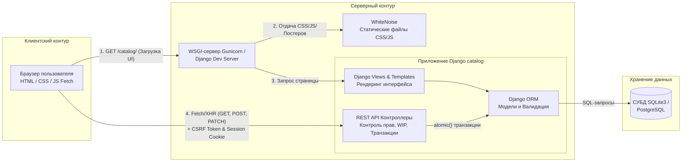

# Архитектура системы и структура проекта

## 1. Структура каталогов и файлов проекта

```text
project_root/
├── manage.py               # Точка входа CLI для управления Django-проектом
├── requirements.txt        # Список зафиксированных зависимостей Python
├── .env.example            # Шаблон переменных окружения без секретных данных
├── README.md               # Основное руководство и быстрый старт
├── docs/                   # Комплект технической документации (СРС №8)
│   ├── architecture.md     # Описание архитектуры и структуры
│   ├── database.md         # Схема моделей БД и бизнес-правил
│   ├── api.md              # Документация маршрутов REST API
│   ├── deployment.md       # Руководство по развёртыванию в облаке Render
│   └── troubleshooting.md  # Диагностика и решение типовых проблем
└── catalog/                # Основное приложение «МедиаТрекер»
    ├── models.py           # Модели БД: Genre, FormatInstance, Title, WatchEntry, EntryEvent
    ├── admin.py            # Настройка таблиц, фильтров и колонок в Django Admin
    ├── views.py            # Контроллеры UI, REST API эндпоинты и транзакционная логика
    ├── serializers.py      # Сериализаторы данных для REST API
    ├── urls.py             # Маршруты каталога и API-операций
    ├── templates/          # HTML-шаблоны пользовательского интерфейса (catalog.html)
    └── migrations/         # Файлы миграций схемы базы данных
```

## 2. Архитектурная схема и границы взаимодействия

