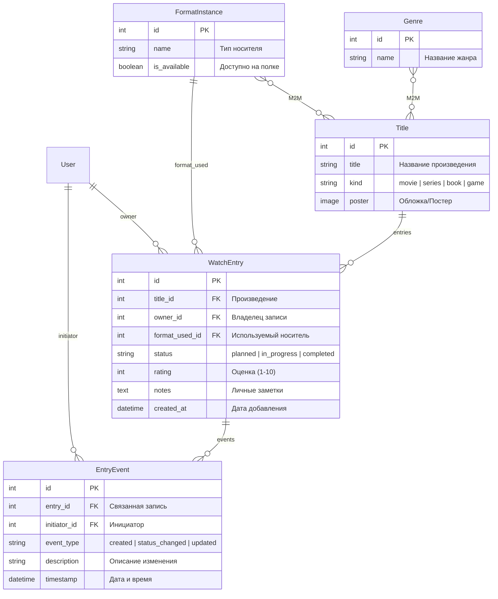

# Схема базы данных и описание моделей

## 1. ER-диаграмма сущностей проекта

## 2. Описание моделей и правил целостности

| Модель | Назначение | Ключевые поля и связи | Бизнес-правила |
| :--- | :--- | :--- | :--- |
| **`Genre`** | Справочник жанров | `name` (CharField, 100) | Связь `ManyToMany` с моделью `Title` для классификации произведений. |
| **`FormatInstance`** | Формат / носитель в личной коллекции | `name` (Бумажная, Цифровая и т.д.), `is_available` (Boolean) | Отражает наличие и статус формата на полке (`Доступно` / `Используется`). |
| **`Title`** | Карточка произведения | `title`, `kind` (фильм/сериал/книга/игра), `genres` (M2M), `formats` (M2M), `poster` | Базовая сущность каталога медиаконтента. |
| **`WatchEntry`** | Запись в личной библиотеке | `title` (FK), `owner` (FK), `format_used` (FK), `status`, `rating` (1-10), `notes`, `created_at` | Контролирует допустимые переходы статуса через словарь `ALLOWED_TRANSITIONS` (`planned` -> `in_progress` -> `completed`). |
| **`EntryEvent`** | Журнал истории личной библиотеки | `entry` (FK), `initiator` (FK), `event_type`, `description`, `timestamp` | Создаётся автоматически в рамках единой транзакции при добавлении записи, смене статуса или обновлении оценки/заметок. |